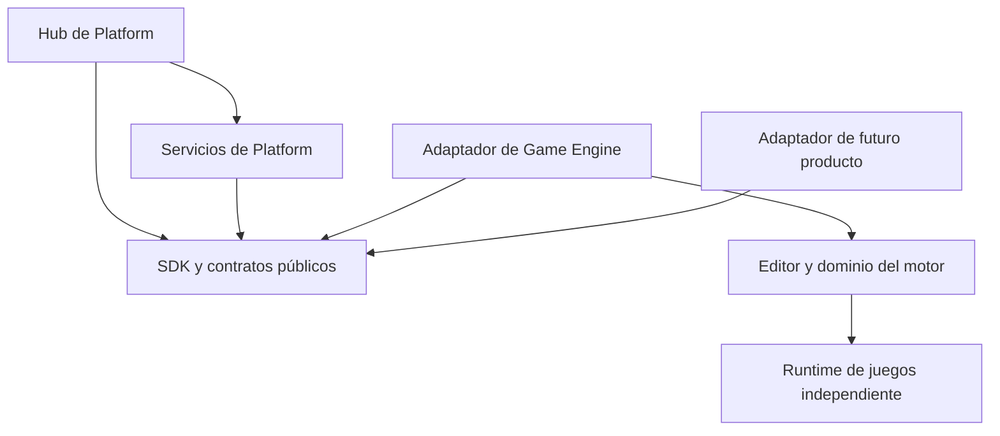

# Arquitectura objetivo

Especificación P0. Las carpetas y paquetes siguientes son destinos previstos, no código ya extraído.

## Capas y dependencias

Platform no depende del adaptador concreto. El host registra un descriptor y conecta una sesión de producto mediante el protocolo público. No importa SceneWorkspace, tipos Unity ni componentes del motor. El SDK describe contratos, clientes y componentes reutilizables; no contiene lógica de gameplay. Los adaptadores viven con su producto.

## Organización prevista

| Repositorio | Destino propuesto | Responsabilidad |
| --- | --- | --- |
| Platform | apps/hub | Catálogo, navegación y ajustes comunes |
| Platform | services/local-host | Ciclo de vida, permisos locales y sesiones |
| Platform | packages/contracts | Manifiestos, mensajes y diagnósticos |
| Platform | packages/sdk | Cliente y utilidades para integración |
| Platform | packages/ui | Componentes visuales extraídos cuando se pruebe su reutilización |
| Platform | services/integrations | Cuentas, transportes externos y ejecución común |
| Game Engine | Adaptador, ubicación a fijar en P1 | Registro, apertura, herramientas y serialización del producto |
| Game Engine | engine, editor y runtime actuales | Funcionalidad especializada |

No se crean todos estos módulos vacíos en P0. P1 elige la mínima estructura ejecutable y la registra.

## Procesos y recursos

Conservar interfaz web más host local. Un proceso por producto o worker se utiliza cuando permita aislar fallos, recursos o trabajos pesados; no se requiere convertir cada servicio en proceso. El host asigna sesiones, controla cierre y muestra errores. GPU y memoria tienen propietario y liberación explícitos por sesión; compartir dispositivo GPU entre productos no es requisito inicial.

## Seguridad local

Conservar loopback, autenticación de sesión, comprobación de origen y protecciones del navegador existentes que apliquen. Rutas canónicas limitadas a raíces autorizadas; no aceptar traversal o escapes mediante enlaces. No publicar el host en la red por defecto. Los permisos pertenecen a una sesión/proyecto y capacidades concretas. No registrar tokens en trazas, documentos o URLs.

## Límites especializados

La UI comparte primitivas, no obliga a todos los productos a tener Hierarchy/Inspector. El motor mantiene renderer, runtime C#, físicas, escenas y exportación. CAD define precisión, restricciones y kernel propios. PMD comparte mecanismos documentales, mientras cada producto define plantillas y aceptación. Los futuros paquetes gráficos o matemáticos requieren evidencia de dos usos y contrato independiente antes de extraerse.
